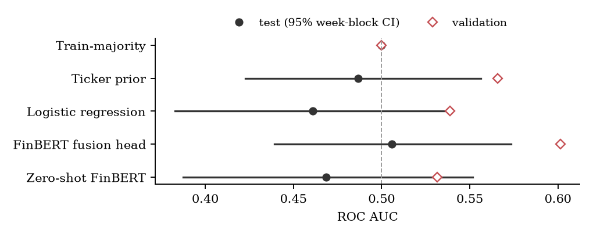

# Financial NLP Earnings Classifier

A reproducible pipeline that asks whether the language of a company's **earnings press release**, encoded by a frozen [FinBERT](https://huggingface.co/ProsusAI/finbert), predicts the **direction of its stock over the next three trading sessions**.

It covers:
- free, exactly timestamped SEC EDGAR data and a leakage-safe information timeline;
- caches that cannot serve stale results;
- synthetic controls that bracket the pipeline;
- a **pre-registered** evaluation on a chronological held-out test set.

**Paper:** [paper/main.pdf](paper/main.pdf) · **Results:** [docs/RESULTS.md](docs/RESULTS.md) · **Protocol:** [docs/PHASE4_PROTOCOL.md](docs/PHASE4_PROTOCOL.md)

> **Research status (2026-10-27): complete, and the real-data result is null.** On 229 held-out events (2024-10-31 to 2026-10-23), no model distinguishes the 3-session direction from chance, and none beats a baseline that only knows each company's historical up-rate. The FinBERT fusion head scores test AUC **0.506** (95% week-block CI 0.439–0.573). The label measures post-announcement *drift*: entry is the open after the release, so the immediate reaction is already in the price. The synthetic controls show the pipeline finds signal when it exists and does not invent it.

---

## Results

The tables below are copied from [`results/phase4/tables.md`](results/phase4/tables.md), which `experiments/report_tables.py` generates from the result files in [`results/`](results/).

### Synthetic pipeline controls (FinBERT, seeds 0–4): pipeline checks, not market evidence

| Control | What it tests | Fusion-head test AUC |
|---|---|---|
| Negative: labels independent of text | the pipeline must not invent signal | 0.465 ± 0.075 (0.392–0.578) |
| Positive: text encodes the label | signal must flow text → FinBERT → head | 1.000 on every seed |

### Real data: SEC earnings press releases, held-out test (evaluated once)

1,138 events from 30 large US tickers. Train 740 events (2016–2023), validation 169 (2023–2024), test 229 (2024–2026). Intervals are 95% bootstrap intervals that resample whole entry weeks (79 weeks).

| Model | Val AUC | Test AUC | 95% CI |
|---|---|---|---|
| Train-majority | 0.500 | 0.500 | [0.500, 0.500] |
| Ticker prior (company up-rate) | 0.566 | 0.487 | [0.423, 0.556] |
| Logistic regression (FinBERT features) | 0.539 | 0.461 | [0.383, 0.538] |
| **FinBERT fusion head** | 0.601 | **0.506** | [0.439, 0.573] |
| Zero-shot FinBERT sentiment | 0.532 | 0.469 | [0.388, 0.552] |

- **Pre-registered claim rule.** Language signal may be claimed only if a FinBERT model beats the ticker prior on the paired bootstrap. It does not: fusion head − ticker prior = +0.019 [−0.052, +0.089].
- **Exploratory headline analysis** (training-free, 111 recent events): zero-shot headline sentiment AUC 0.429 [0.323, 0.556].
- **Not trading performance.** Classification metrics are not trading returns.



---

## Why the result can be trusted

1. **Information timeline in US Eastern time.**
   - Headlines must be published before 00:00 ET on the announcement date, or before the release's SEC acceptance time if that is earlier.
   - The prediction happens at the 09:30 open of the first trading day after both the announcement and the document are public.
   - The label is the sign of the return from that open to the close of the 3rd session.
   - Every invariant is re-checked on the stored data.
2. **Official, exactly timestamped documents.** Each release is Exhibit 99.1 of the company's Form 8-K Item 2.02 filing, dated by its EDGAR acceptance time. Coverage gaps are documented, not hidden ([docs/DATA_SOURCES.md](docs/DATA_SOURCES.md)).
3. **Chronological, date-grouped, purged split.** Same-date events stay together, and training labels never overlap a later split.
4. **Two controls bracket the pipeline.** The negative control must be about 0.5 and the positive control about 1.0.
5. **A ticker-identity baseline.** Releases name their company, so a model can beat 0.5 just by recognising firms that kept rising. Beating the ticker prior is the bar.
6. **Pre-registration.**
   1. The protocol was committed before any real-data training.
   2. Model selection used validation data only and was committed before testing.
   3. The test stage refuses to run unless that selection is committed, and the test set was evaluated once.

   The public repository starts from a single commit, so this order is documented in the protocol's change log and in the development-history commit identifiers stored in the result files, not in the public git history, and it was not lodged with an external registry.
7. **Dependence-aware uncertainty.** A bootstrap over entry weeks, because events in the same week share market moves.
8. **Provenance.**
   - Explicit data modes that never fall back to synthetic data.
   - Event and embedding caches keyed on every input that can change them, including the pinned model revision and the encoding device.
   - Frozen, fingerprinted datasets.
   - A manifest for every run.

---

## Architecture

```
 Earnings press release ───► [≤8 × 384-tok chunks] ► FinBERT ──► mean-pool ──┐
                                  (frozen, pinned)                          │
                                                                   ┌────────▼────────┐
                                                                   │  Fusion          │
                                                                   │  [t ; n ; |t−n| ; │──► linear head ─► σ ──► P(up)
                                                                   │   t·n ; presence] │
                                                                   └────────▲────────┘
 News headlines ──────────► [each ≤48 tok] ──────► FinBERT ──► mean-pool ──┘
```

- **Document stream.** Documents are split into consecutive, non-overlapping 384-token chunks, keeping at most 8. Each chunk is encoded and mean-pooled.
- **Headline stream.** Headlines form a small bag that is encoded the same way. A missing stream is zeroed, and a presence flag records it.
- **Head.** The default head is dropout plus **one linear layer** over the fused features (3,075 parameters with both streams). `head_layers ≥ 1` adds a hidden layer.
- **Encoder.** FinBERT stays frozen, so embeddings are computed once and cached. `--finetune` trains end to end (GPU recommended; not used in the reported results).
- **Real benchmark.** It uses the document stream only: free headline history covers only the test period ([protocol §1](docs/PHASE4_PROTOCOL.md)).

---

## Install

Tested with Python 3.13.17 on macOS arm64. CI uses Ubuntu with CPU-only torch.

```bash
uv venv --python 3.13 .venv                                        # or: python3.13 -m venv .venv
uv pip install --python .venv/bin/python -r requirements-lock.txt  # exact tested versions
# or the compatible ranges: -r requirements-dev.txt
```

The device is chosen automatically: Apple-silicon MPS, then CUDA, then CPU. Model weights are pinned to exact Hugging Face commits.

## Quick demo (about a minute on CPU, no credentials)

```bash
.venv/bin/python -m pytest -m "not slow"     # network-free unit tests
.venv/bin/python -m pytest -m slow           # tiny-BERT end-to-end smoke test (~17 MB download)
.venv/bin/python main.py --preset tiny --data-mode synthetic-positive-control --device cpu
.venv/bin/python main.py --preset tiny --data-mode synthetic-negative-control --device cpu
```

Each run writes `runs/<UTC timestamp>_<mode>_<fingerprint>/` containing:
- `manifest.json`: config, seed, argv, fingerprints, cache keys, model revision, split counts, dependency versions and git commit;
- `metrics.json`;
- `predictions.csv`;
- the trained head, which is not committed.

## Data modes

| `--data-mode` | Text | Purpose |
|---|---|---|
| `synthetic-negative-control` | stock sentences; labels independent of the text | must score ≈ 0.5 |
| `synthetic-positive-control` | bullish or bearish text that encodes the label | must score ≫ 0.5 |
| `real` | SEC EDGAR press releases (`--documents sec-edgar`, default) and/or Finnhub headlines (`--headlines finnhub`) | the market experiment |

Real mode never falls back to synthetic data. Without a text provider, or with too few usable events, it stops and prints a coverage report.

**Credentials.** Real mode needs credentials, supplied only through environment variables (see [`.env.example`](.env.example)):
- `SEC_EDGAR_USER_AGENT`: a contact string, which the [SEC requires](https://www.sec.gov/os/accessing-edgar-data). The client stays under SEC's 10 requests/second limit.
- `FINNHUB_API_KEY`: needed only for headlines.
- `FMP_API_KEY`: needed only for `--documents fmp` (call transcripts, paid plan).

Load them with `set -a; source .env; set +a`. No credential value is written to caches, manifests or logs.

## Reproduce the real benchmark and the paper

```bash
python main.py --data-mode real --headlines none --collect-only   # collect + coverage report
python experiments/phase4.py select                                # validation only
git add results/phase4/selection.json && git commit -m "selection"
python experiments/phase4.py test                                  # runs once; needs committed selection
python experiments/phase4.py headlines                             # exploratory, training-free
python experiments/summarize_controls.py runs/controls-finbert
python experiments/dataset_summary.py && python experiments/paper_assets.py
cd paper && tectonic -X compile main.tex
```

- **Frozen datasets.** The datasets used here are not redistributed, because they contain provider data. Their fingerprints and SHA-256 hashes are in [docs/STATUS.md](docs/STATUS.md).
- **Fresh collections drift.** A fresh collection builds a similar but not identical dataset, because provider data change over time.
- **Generated assets.** CI checks that the paper's generated number and table files match the committed results.

---

## Repository map

```
earnings_classifier/    pipeline package
  timing.py               ET sessions, trading days, label windows
  providers.py            Yahoo / SEC EDGAR / FMP / Finnhub; redaction; raw cache
  data_collection.py      real + synthetic events, validation, purged split, frozen loading
  cache.py, provenance.py provenance-keyed caches, run directories, manifests
  preprocessing.py, model.py, embeddings.py, train.py   FinBERT features and heads
  baselines.py            train-majority, logistic regression, ticker prior
  zeroshot.py             FinBERT's own sentiment classifier as a baseline
  uncertainty.py          week-block bootstrap, paired differences
  selection.py            pre-registered selection + committed-selection guard
experiments/            Phase 4 runner, controls summary, dataset summary, paper assets
results/                result files (JSON) and generated tables
runs/                   control run manifests/metrics; legacy pre-audit run
paper/                  LaTeX source, bibliography, generated assets, compiled PDF
docs/                   plan, status + verification log, data sources, protocol, results
tests/                  network-free unit tests + tiny-BERT smoke test
```

## Limitations

- **Drift, not reaction.** The label starts after the announcement reaction. Whether release text explains the reaction itself was not tested.
- **Precision.** About ±0.07 AUC on 229 test events. Smaller effects cannot be detected.
- **Truncation.** Only the first ~380 tokens (the selected setting) or ~3k tokens of releases with a median of 6,862 tokens are encoded. The pipeline uses no transcripts, no analyst Q&A, no earnings-surprise data, and no fine-tuning.
- **Survivorship bias.** The universe is today's 30 large caps, projected back to 2016. ExxonMobil is effectively absent, and Disney has no documents before 2019.
- **Short headline history.** Free headline history covers about a year, so headlines appear only in the exploratory analysis.
- **Not financial advice.** This is a research and engineering reference.

## Attribution

- **Models (downloaded at pinned revisions, not redistributed):**
  - [ProsusAI/finbert](https://huggingface.co/ProsusAI/finbert): Araci (2019), [arXiv:1908.10063](https://arxiv.org/abs/1908.10063). Its model card names no license at the pinned revision.
  - [google/bert_uncased_L-2_H-128_A-2](https://huggingface.co/google/bert_uncased_L-2_H-128_A-2): Turc et al. (2019), Apache-2.0 per its model card.
- **Data (none redistributed):**
  - SEC EDGAR filings.
  - Yahoo Finance via [`yfinance`](https://github.com/ranaroussi/yfinance) (subject to Yahoo's terms).
  - [Finnhub](https://finnhub.io) company news (subject to Finnhub's terms).
- **Libraries:** PyTorch, Hugging Face Transformers, scikit-learn, NumPy, pandas, matplotlib, pytest; the paper builds with [Tectonic](https://tectonic-typesetting.github.io).

## License

The code is released under the [MIT License](LICENSE). Pretrained models and provider data remain under their own licenses and terms.
